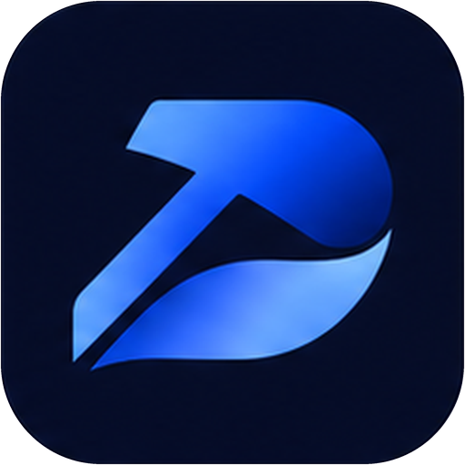
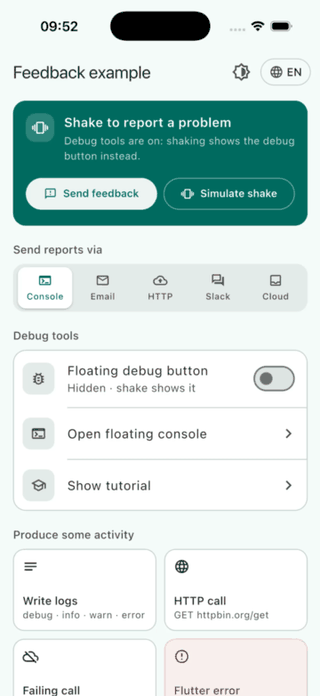
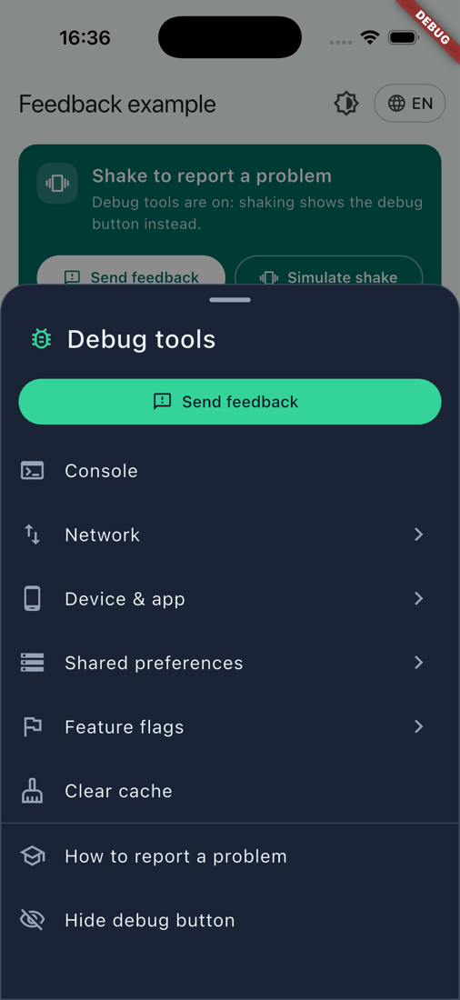
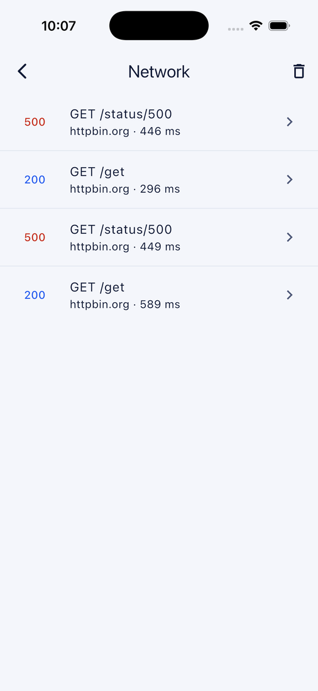
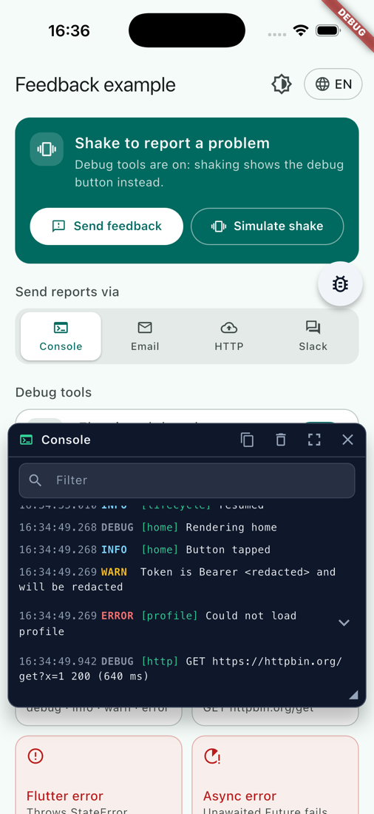

<p align="center">
  
</p>

# Planish

*Great products are refined, not just built.*

**An in-app feedback toolkit for Flutter, with the context your team needs to act.**

[](https://pub.dev/packages/planish)
[](https://pub.dev/packages/planish/score)
[](https://pub.dev/packages/planish/score)
[](https://github.com/kindware-dev/planish-flutter/actions/workflows/ci.yml)
[](LICENSE)

Users report bugs, ideas and questions from inside your app. Planish
captures their message, an annotated screenshot and the technical context
around it: logs, screen changes, HTTP activity, device facts and app state.

<p align="center">
  
</p>

<p align="center">
  
  
  
</p>

## Why Planish

Your team gets a report it can act on instead of a screenshot and a vague
description: the user's words and the context travel together, tagged with
the build they came from, with a Markdown brief for an issue or a coding
agent. Send it by email, to your own API, or to Planish Cloud.

**No mandatory backend.** No account needed for email or your own API.
Nothing leaves the device until the user presses **Send**, unless you turn
on `autoSendErrors`. Error handlers are chained, not replaced: Crashlytics,
Sentry and your logger keep working.

> **Planish Cloud: managed inbox and MCP.** Prefer a hosted inbox to
> building your own backend? Planish Cloud collects feedback from your
> Flutter apps and websites in one place, with triage, comments and an MCP
> server for your coding agent: your app → the inbox → Claude Code, Cursor
> or Codex. [Explore Planish Cloud →](https://planish.kindware.eu)

## Quick start

```yaml
dependencies:
  planish: ^0.1.0
```

```dart
import 'package:planish/planish.dart';

Future<void> main() async {
  await Planish.init(
    PlanishConfig(
      sender: EmailFeedbackSender(to: ['support@example.com']),
      categories: FeedbackCategory.defaults, // bug, idea, question, other
    ),
  );
  runApp(const MyApp());
}

class MyApp extends StatelessWidget {
  @override
  Widget build(BuildContext context) {
    return MaterialApp(
      builder: Planish.builder(), // works with MaterialApp.router too
      home: const HomePage(),
    );
  }
}
```

**To Planish Cloud instead of e-mail**: create an app on
[Planish Cloud](https://planish.kindware.eu) to get its ingest key, then:

```dart
sender: PlanishCloudSender('pl_…', server: 'https://planish.kindware.eu'),
```

**With a coding agent**: point Claude Code, Cursor or Codex at
[`doc/agent-integration.md`](doc/agent-integration.md) and it integrates
Planish for you, asking you the right questions first.

That is the whole setup. Three things can open from code:

| Call | Opens | For |
|---|---|---|
| `Planish.show()` | the feedback form: category, message, screenshot, logs, Send | your users, every build |
| `Planish.prompt()` | the small "Share feedback" sheet, then the form; this is what a shake or another feedback gesture opens | your users, every build |
| `Planish.debugTools.show()` | the floating debug button; tapping it opens the debug menu (console, network, device, preferences) | your team, debug and profile builds |

Wire `Planish.show()` to any button, menu entry or settings tile of your own;
it resolves when the form closes.

Add `navigatorObservers: [Planish.navigationObserver]` (or the
equivalent `observers` on your router) to log screen changes and name the
current screen in every report.

Or let users shake the phone, in every build type:

```dart
PlanishConfig(
  sender: ...,
  reportGestures: {TriggerGesture.shake},   // also multiFingerTap, edgeSwipe
  tutorial: TutorialConfig(showOnFirstLaunch: true), // 4-step walkthrough, shown once
)
```

A shake first opens a small sheet, "Share feedback", with "Report a
problem", "Share an idea" and "Ask a question", the way Google or Instagram
apps do; picking one
opens the form with that category selected. `Planish.prompt()` opens
the same sheet from code. Tune it, or replace it:

```dart
quickReport: QuickReportConfig(
  title: (context) => L10n.of(context).somethingWrong,
  actions: (context) => [
    QuickReportAction(icon: Icons.bug_report_outlined, label: 'Report a bug', category: FeedbackCategory.bug),
    QuickReportAction(icon: Icons.chat_outlined, label: 'Chat with us', onTap: (_) => openChat()),
  ],
  // builder: (context) => MySheet(),   // your own widget; see PlanishModal
  // enabled: false,                    // gestures open the form directly
),
```

## How it works

1. **The user shares feedback.** A button or a shake opens the form over
   the current screen. They pick a category (bug, idea, question, other),
   write a line, draw on the screenshot, and can open "What will be sent?"
   to see the exact content.
2. **Planish gathers the context.** The timeline, the current screen, app
   and device facts, the build commit, and the state snapshots you
   registered. Everything goes through the redactors; nothing is uploaded
   on its own.
3. **Your team reviews and acts.** The report arrives where you chose, with
   a brief that reads top to bottom: message, error if any, what the app was
   doing, the timeline.

For the same tap on "Send":

| Without | With Planish |
|---|---|
| "The button doesn't work" and a screenshot | The same words, the screenshot with a circle around the button, `app.version 1.4.2+37`, `build.commit 9f3c1e2`, `screen CheckoutRoute`, the 3 minutes of logs before the tap including `POST /orders 500 (1 204 ms)`, the state snapshot `cart.items 3`, and the uncaught `FormatException` with its stack trace |

Not every report has an error or a failing call; the brief says what it
found and what it did not.

### What goes into a report

**The timeline** is the `Log` buffer: what you log, plus what the package
adds on its own.

```dart
Log.info('cart loaded', tag: 'cart');
Log.error('checkout failed', error: e, stackTrace: s, tag: 'cart');

final client = LoggingHttpClient(http.Client());   // HTTP calls, redacted
MaterialApp(navigatorObservers: [Planish.navigationObserver]); // screen changes
```

Uncaught errors (with the widget that caused them) and lifecycle changes
are logged by the package. Debug entries stay in the buffer in release
builds, so the trail is there when a report is sent. Already on
`package:logging`, `logger`, `talker` or Dio? They plug in; see
[Logging and errors](https://github.com/kindware-dev/planish-flutter/blob/main/doc/logging-and-errors.md).

**Who and where** come from your code, once:

```dart
Planish.setUser(id: user.id, email: user.email);   // on login; clearUser() on logout
Planish.setTag('tenant', 'acme');
```

**The state of the app** at the moment of the report comes from providers
you register, one per subsystem, returning short key/value pairs:

```dart
reportContext: [
  ReportContext(() => {'cart.items': '${cart.items.length}', 'sync.pending': '${outbox.length}'}),
],
analysisNotes: (report) => 'Tags: cart = CartController, sync = SyncService.',
```

`analysisNotes` is a fixed text for whoever reads the report: how tags map
to classes, where to start. Pass `--dart-define=PLANISH_COMMIT=$(git rev-parse --short HEAD)`
at build time and the brief names the commit that was running.

**After a crash**, the logs are still there: the buffer is persisted to a
bounded file, and when the previous launch ended in the foreground the next
report says so (`app.previousExit: abnormal`) and attaches that launch's
logs.

**Nothing typed is lost**: a form closed before sending is kept as a draft,
with what the app was doing when it opened, and offered again next time.
With `prompts: PromptMode.notify`, an uncaught error prepares a draft itself
and a small card offers to add details.

**The report** is a `FeedbackReport`: message, category, screenshot, error,
logs, context, attachments, with `toJson()` (one object per log entry) and
`toMarkdown()` (the brief). `EmailFeedbackSender` uses the brief as the
mail body; `HttpFeedbackSender` posts everything as multipart with
`brief.md`, `logs.txt` and `screenshot.png`; `PlanishCloudSender` does the
same to a Planish Cloud inbox with just its ingest key; `CallbackFeedbackSender` or
your own `FeedbackSender` for anything else. Every option is in
[Configuration](https://github.com/kindware-dev/planish-flutter/blob/main/doc/configuration.md).

### Debug tools

In debug and profile builds, a shake shows a floating button that opens
the debug menu: a floating console over the running app, the network log
of `LoggingHttpClient`, device facts, a shared preferences viewer, and your
own `DebugActionPlugin` / `DebugPagePlugin` entries. Off in release by
default; `Planish.debugTools.allow(true)` turns them on for the users you
choose, testers or yourself, once your app knows who is signed in. Details in
[Debug tools](https://github.com/kindware-dev/planish-flutter/blob/main/doc/debug-tools.md).

## Privacy and collected data

| Data | Default | Setting |
|---|---|---|
| Screenshot (annotated, PNG) | on, user can remove | `includeScreenshot` |
| Log entries (redacted) | on, user can untick | `includeLogs` |
| App name and version, OS, device model, locale, build mode, time zone, memory use, session id, uptime, lifecycle state | on | `deviceInfo: DeviceInfoLevel.basic` |
| Manufacturer, hardware, screen, platform device id | off | `DeviceInfoLevel.full` |
| Shared preferences (keys and values) | **off** | `includeSharedPreferences` |
| HTTP calls through `LoggingHttpClient`: method, redacted URL, status, duration | in the logs | use a plain `http.Client` to opt out |
| Request and trace ids of the calls around an error (`x-request-id`, `traceparent`…) | on | `traceHeaders` adds your own header names |
| HTTP bodies | never | — |
| Logs of the previous launch, when it ended in the foreground | on | `persistLogs` |
| Drafts of unsent reports, on the device only, for 30 days | on | `keepDrafts` |
| Uncaught errors sent without the user pressing Send (error, trace, context, logs; no screenshot or message) | **off** | `autoSendErrors`: your decision, to declare in your privacy policy |
| State snapshots | what your `reportContext` providers return | `reportContext` |

- `Authorization`, `Cookie`, `X-Api-Key`… are replaced by `<redacted>` in the
  network log; `token`, `api_key`, `password`… are hidden in URLs.
- Bearer tokens and JWTs are redacted in every log line. Add your own:
  `redactors: [Redactors.email, Redactors.creditCard, Redactors.pattern(myRegExp, '<x>')]`.
- `beforeSend` is the last word: return a modified report, or `null` to cancel.
- Nothing is uploaded automatically, unless you turn `autoSendErrors` on for
  your own builds. The email sender hands the report to the user's mail
  client; the user still presses send there.

If you enable `DeviceInfoLevel.full` or a prompt on error in a store build,
declare it in your privacy policy and store data-safety forms.

## Works with what you have

| | Android | iOS | Web / desktop |
|---|---|---|---|
| Feedback form, logs, debug tools | ✅ | ✅ | not tested yet |
| `EmailFeedbackSender` | ✅ | ✅ | ❌ |

- **Routers**: `builder:` works with `MaterialApp.router`, go_router and
  auto_route; an existing builder is nested with `inner:`.
- **Crash reporters**: `FlutterError.onError` and `PlatformDispatcher.onError`
  are chained, so Crashlytics or Sentry keep working in any init order.
- **Logging**: `package:logging` in one line, `dart:developer` `log` by
  swapping an import, `logger` / `talker` through a sink, Dio through an
  interceptor.
- **State management**: nothing to do; `Planish` is static.
- **Your widget tests**: the default config stays out of the way under
  `flutter test`: no `debugPrint` swap, no sensor stream, no screenshot.

The recipes are in [Working with other packages](https://github.com/kindware-dev/planish-flutter/blob/main/doc/integrations.md).

What runs in a store build with the defaults:

| | Debug / profile | Release |
|---|---|---|
| Error handlers, `Log` buffer, redaction | on | on |
| `Planish.show()`, `reportGestures` | on | on |
| Automatic draft and card after an uncaught error | off | off (`prompts`) |
| Debug button, console, network log, prefs viewer | on | **off**, unless your app calls `Planish.debugTools.allow(true)` for a user |
| `debugPrint` capture | on | off (`captureDebugPrint`) |
| `Log.minLevel` | `debug` | `info` |

How to gate the tools, pass build defines and keep symbols:
[Release builds and production](https://github.com/kindware-dev/planish-flutter/blob/main/doc/production.md).

## Using an AI coding agent

An AI coding agent can do two things with Planish. Given a report's brief,
it has the context to understand the feedback and find the code it
concerns, and can work on a change from there, under your review. And it can
integrate the package for you.

Integrating with Claude Code, Codex, Cursor or Copilot? Point the agent at
[`doc/agent-integration.md`](doc/agent-integration.md): working rules, the
questions to ask you first, ordered steps with code, the checks at the end
and the things not to do. [`llms.txt`](llms.txt) is the short index.

```text
Integrate the planish package into this app by following
https://raw.githubusercontent.com/kindware-dev/planish-flutter/main/doc/agent-integration.md
```

## Going further

- [Configuration](https://github.com/kindware-dev/planish-flutter/blob/main/doc/configuration.md): every option, senders,
  categories, the quick sheet, the tutorial, theming, localization.
- [Logging and errors](https://github.com/kindware-dev/planish-flutter/blob/main/doc/logging-and-errors.md): `Log`, sinks,
  redaction, error handlers, the persisted log file.
- [Debug tools](https://github.com/kindware-dev/planish-flutter/blob/main/doc/debug-tools.md): console, network, device,
  preferences, plugins.
- [Working with other packages](https://github.com/kindware-dev/planish-flutter/blob/main/doc/integrations.md).
- [Release builds and production](https://github.com/kindware-dev/planish-flutter/blob/main/doc/production.md).
- [Example app](https://github.com/kindware-dev/planish-flutter/tree/main/example/lib):
  senders switched at runtime, a log sink, debug plugins, report context.
- [Changelog](https://github.com/kindware-dev/planish-flutter/blob/main/CHANGELOG.md).

## Limitations

- Screenshots capture Flutter content only. Platform views (maps, web views,
  native video) render as blank areas.
- `EmailFeedbackSender` needs a configured mail account; on the iOS simulator
  there is none, and the form shows the error.
- Web and desktop compile but have not been tested.

## Contributing

Bug reports and feature requests go to the
[issue tracker](https://github.com/kindware-dev/planish-flutter/issues).
Pull requests are welcome; see [CONTRIBUTING.md](CONTRIBUTING.md) for the
setup and the checks the CI runs.

## License

[MIT](LICENSE)
